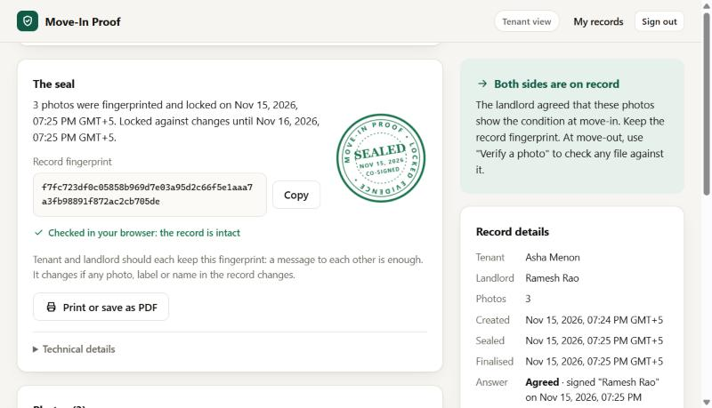
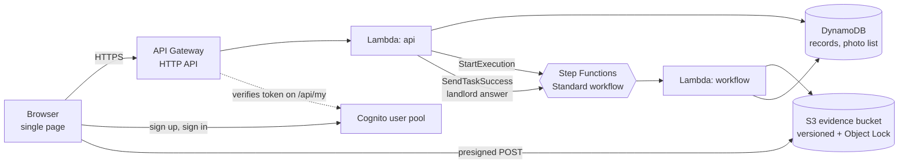

# Move-In Proof

Sealed, co-signed evidence of what a rented home looked like on day one.
Built by **Syed Moiz** for the AWS Builder Center weekend challenge "No Pipeline, No Problem".

- **Live app:** https://hpst16vp30.execute-api.us-east-1.amazonaws.com/
- **Demo video:** https://www.youtube.com/watch?v=9Gith267CSc
- **Full write-up with screenshots:** [SUBMISSION.md](SUBMISSION.md)



## The problem

When a tenant moves out, deductions from the security deposit are argued from phone photos.
Either side can say the other's photos were taken later, edited, or are of a different flat.
Nobody can prove otherwise.

## What it does

1. The tenant creates an account (Amazon Cognito), starts a record and uploads move-in photos.
   Records stay in the account under "My records".
2. On "Seal", a Step Functions workflow fingerprints every photo (SHA-256), locks each exact
   S3 object version with Object Lock, and writes a locked manifest listing every fingerprint.
3. The tenant sends the landlord a co-sign link. The workflow waits on a task token.
   Nothing runs while it waits. The landlord needs no account; if they do sign in, their
   verified email is recorded with the answer.
4. The landlord agrees or disputes, once. If the window passes with no answer, the record is
   finalised as "sealed by the tenant only".
5. At move-out, anyone with the public link can pick a photo and check it against the seal.
   The check runs in the browser; the file is never uploaded. One changed byte gives "NO MATCH".

## Architecture



The workflow (`statemachine/seal.asl.json`):

```
ListPhotos
   -> HashAndLockEachPhoto   (Map: SHA-256 the bytes, lock that object version)
   -> SealManifest           (write manifest.json with Object Lock)
   -> WaitForLandlord        (waitForTaskToken, timeout = co-sign window)
        answered  -> FinalizeWithLandlordAnswer   (co-signed or disputed)
        timed out -> FinalizeTenantOnly
   any failure before the wait -> RevertToDraft -> Fail
```

| Service | Job |
|---|---|
| Cognito user pool | Registration, email confirmation, sign-in, password reset |
| API Gateway (HTTP API) | `$default` (open) and `/api/my/{proxy+}` (JWT authorizer) in front of one Lambda |
| Lambda `api` | Serves the page at `/` and the JSON API under `/api` |
| Lambda `workflow` | The small steps the state machine calls |
| Step Functions | Ordering, per-photo fan-out, the wait for a human, the timeout |
| DynamoDB (on-demand) | Record status and the draft photo list; conditional writes stop double seals and double answers |
| S3 (versioned, Object Lock) | Photos, `manifest.json`, `seal.json` |

Design choices worth reusing:

- **The page is served by the API Lambda.** No CloudFront, no second bucket, no CORS on the API.
- **Two doors, one handler.** `/api/...` is open; `/api/my/...` sits behind the API Gateway JWT
  authorizer. Owner-only actions need Cognito claims, so they can only succeed through the second
  door, and the Lambda never verifies a token itself.
- **The page calls Cognito directly** with `fetch`. No SDK, no build step, no hosted login page.
- **The landlord's link secret lives in the URL fragment**, which browsers do not send to servers.
- **After sealing, S3 is the source of truth.** The photo list is read from the locked manifest,
  not from DynamoDB.
- **The manifest pins object versions.** Re-uploading to the same key creates a new version that
  the record ignores.
- **No email or SMS.** The tenant shares the co-sign link over whatever they already use, so there
  is no SES sandbox or SMS registration to wait for.

## Deploy

You need an AWS account and the AWS CLI signed in. No SAM CLI and no pipeline are required.

```bash
./deploy.sh
```

It prints the app URL. Demo defaults are a 120-second co-sign window and a 1-day lock; for real
use set `COSIGN_WINDOW=259200 RETENTION_DAYS=365` (or your lease length) before running it.

With the SAM CLI (preinstalled in AWS CloudShell) the equivalent is `sam build` then
`sam deploy --guided`.

## Try it without AWS

```bash
python tests/dev_server.py 8787 60
```

This runs the real page and handlers at http://localhost:8787 with AWS replaced by memory and a
60-second landlord window. Accounts live in memory and the emailed code is always 123456. It is
for rehearsal only and stores nothing.

## Tests

```bash
python -m unittest discover -s tests -v
```

22 tests drive the API and workflow handlers through an in-memory stand-in for AWS: the agree,
dispute and timeout paths, swapping a photo after sealing, adding photos after sealing, sealing
twice, answering twice, and using the wrong link for each action.

## What has and has not been verified

- Verified: the 22 tests pass, and the page was driven end to end in a browser against the local
  server (create, label and upload, remove a photo, full-size view, seal, match, no-match on a one-byte change, landlord co-sign with confirmation, registration, sign-in and My records against a stand-in for Cognito).
- The print layout was checked by applying the print styles on screen, not from a real printout or saved PDF.
- Verified on the deployed stack (us-east-1, 15 Nov 2026) with a seeded test record: the workflow
  ran ListPhotos, the Map state, SealManifest and parked on WaitForLandlord; the live API returned
  the record with a matching manifest and photo fingerprint and an Object Lock date; deleting the
  locked photo version and shortening its lock were both refused by S3 ("protected by object
  lock"); after the 120-second window the run finished through FinalizeTenantOnly. The JWT route
  returns 401 without a valid token.
- Also verified on the deployed stack, in a browser: registration with an emailed Cognito code and
  sign-in; creating a record; uploading two photos through presigned POST and viewing them;
  sealing; the landlord opening the co-sign link without an account and agreeing; the run
  finishing through FinalizeWithLandlordAnswer; an original photo verifying as "Match" and a copy
  with one byte added as "No match".
- Not verified on the deployed stack: password reset, a landlord co-signing while signed in
  (checked locally only), dark mode and the printed layout.

## Limits

- **A co-sign without an account proves who held the link, not who the person is.** The owner's
  own account is refused, but a dishonest tenant could sign out and open the link. A co-sign made
  while signed in carries a verified email, which is the stronger form.
- **The seal proves the files are unchanged since sealing, not when the photos were taken.**
  Seal on move-in day.
- **The lock is Object Lock in governance mode.** An account administrator with the bypass
  permission can still delete objects. Compliance mode removes that, but then nobody can delete
  test data early either.
- Cognito's built-in email sender is limited to a small number of messages a day, which is fine
  for a demo and not for production.
- Photos are JPEG, PNG or WebP, up to 10 MB each and 30 per record.

## Cost

Everything is pay-per-use and idles at zero: no provisioned capacity, no always-on compute.
A seal of N photos is roughly N + 6 Step Functions state transitions and a handful of Lambda
invocations. The standing cost is S3 storage for the photos you keep.

## Clean up

Locked objects cannot be deleted until their retention date passes. After that, empty the
evidence bucket (all versions) and delete the stack:

```bash
aws cloudformation delete-stack --stack-name move-in-proof
```

## Demo script (under 3 minutes)

1. The problem in one sentence, over a photo of a wall (15 s).
2. Create a record, upload three photos, press Seal. Show the Step Functions graph with the Map
   state finishing and the workflow parked on WaitForLandlord (40 s).
3. Open the landlord link in another window, look at the photos, agree. Show the workflow finish
   and the status turn to co-signed (30 s).
4. Open the public link. Verify an original photo: MATCH. Open the same photo in an editor,
   change one pixel, save, verify again: NO MATCH (40 s).
5. Second record: seal, do nothing, let the 120-second window pass, show "sealed by the tenant
   only" (20 s, cut the wait).
6. The architecture diagram and the one-command deploy (25 s).
