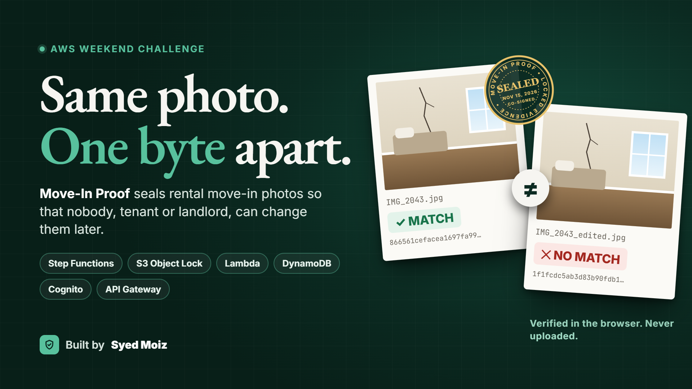

# Move-In Proof: move-in photos that neither tenant nor landlord can change later

**Weekend Challenge: No Pipeline, No Problem** · built by **Syed Moiz**

**Tags:** #serverless #aws-step-functions #aws-lambda #amazon-s3 #amazon-dynamodb #amazon-cognito

| | |
|---|---|
| **Live app** | https://hpst16vp30.execute-api.us-east-1.amazonaws.com/ |
| **Demo video (1 min 41 s)** | https://www.youtube.com/watch?v=9Gith267CSc |
| **Code** | https://github.com/SYMOIZ/move-in-proof |

> **Trying the live app:** create a free account with any email you can read (Cognito sends a 6-digit
> code), start a record, add photos and seal it. The landlord's co-sign window is 120 seconds in this
> deployment so the whole flow, including the timeout path, can be seen in minutes.

**Short on time? Two minutes is enough:** watch the video, then open the live app and press "Create
account". Everything described below was run on the deployed stack, not only on a laptop.

---

## TL;DR

A tenant uploads move-in photos. A **Step Functions** workflow fingerprints every photo with SHA-256,
locks it in **S3 with Object Lock**, and then **waits, with nothing running**, for the landlord to
co-sign through a link. At move-out, anyone can check a photo against the seal in their browser:
the original gives **Match**, the same file with one byte changed gives **No match**.

One SAM template, no servers, no pipeline, and it costs nothing when idle.

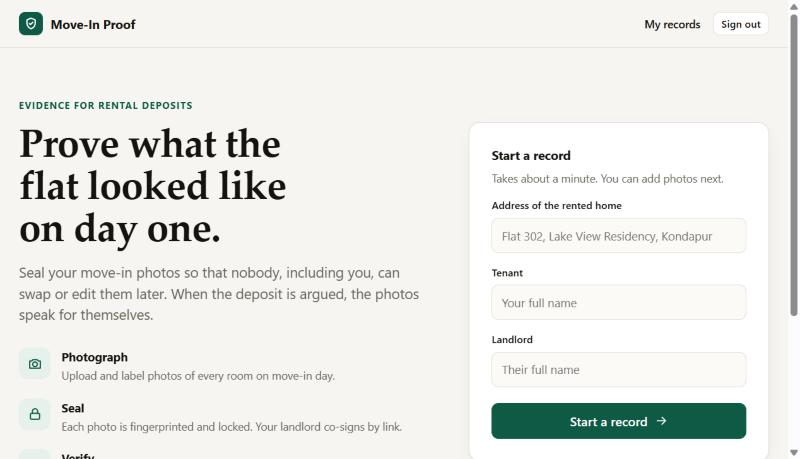

## The problem

Anyone who has rented a home knows the moment: the lease ends, and the deposit comes back with
deductions. The tenant says the crack in the wall was there on day one. The landlord says the photo
was taken last week. Both have files, and neither file proves when it was made or whether it was
edited. A shared folder does not help, because whoever owns the folder can replace what is in it.

The missing piece is small: a copy of the move-in photos that **neither side can alter**, that both
sides **acknowledged at the start**, and that **anyone can check later**.

## What it does

### 1. The tenant starts a record

The tenant signs in (Amazon Cognito) and starts a record for the flat. Records live in the account,
so there is no link to lose.

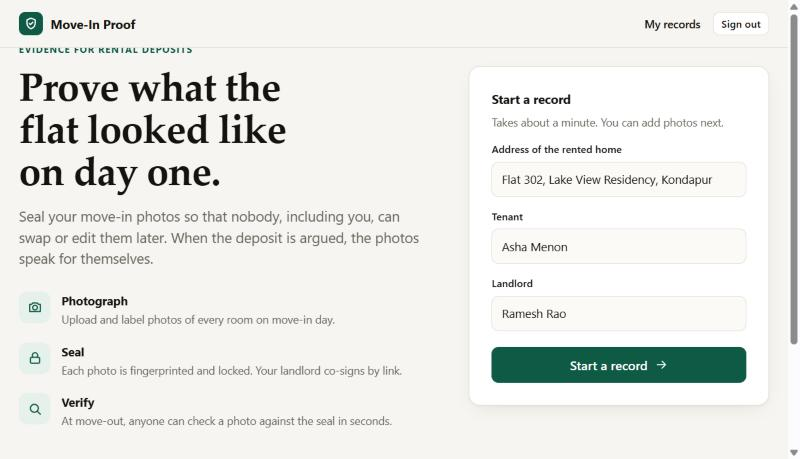

### 2. Add and label photos

Photos upload straight to Amazon S3 through presigned POSTs. Every photo needs a label, so it can
be recognised months later.

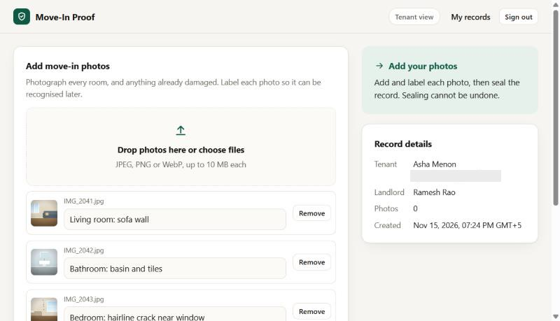

### 3. Seal the record

Sealing is one confirmed click. After that, photos cannot be added, changed or removed.

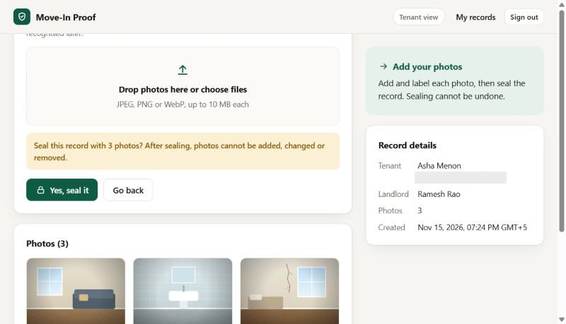

A Step Functions workflow takes over: a Map state hashes every photo and locks that exact S3 object
version, then a locked manifest listing every fingerprint is written. The record is now waiting for
the landlord, and the tenant gets two links to share.

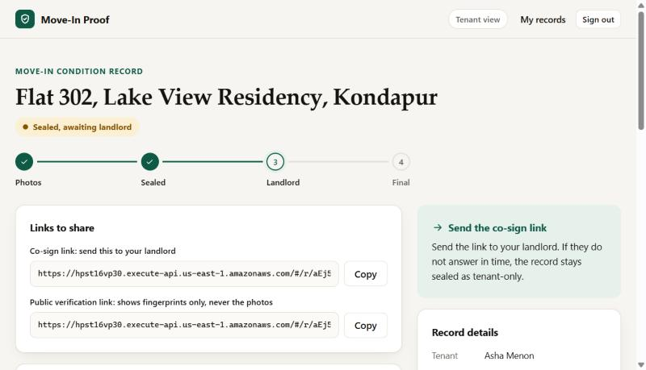

The seal shows one fingerprint for the whole record. Change any photo, label or name and it no
longer matches. The page re-computes it in the browser as a check.

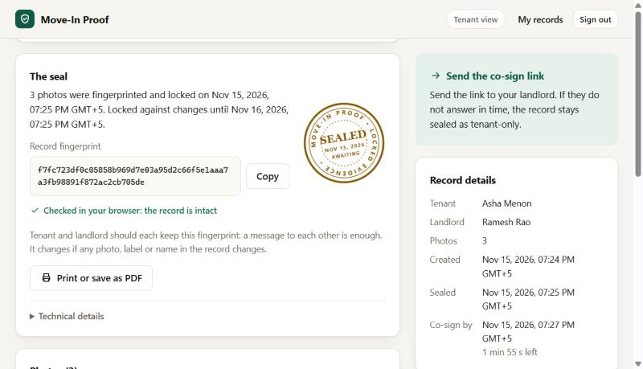

### 4. The landlord co-signs

The landlord opens a link. **No account is needed.** They can inspect every photo, then agree or
dispute, once, with their name. A dispute needs a reason. The answer is confirmed before it is
recorded.

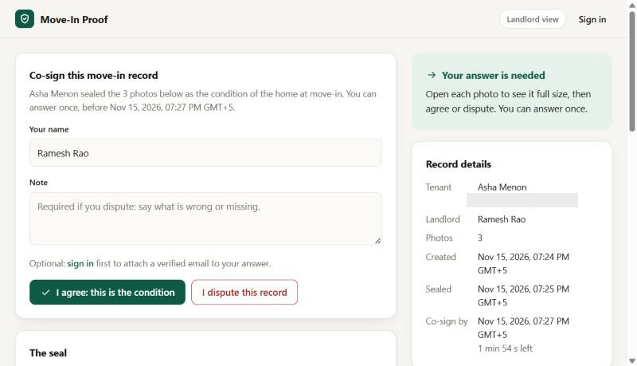

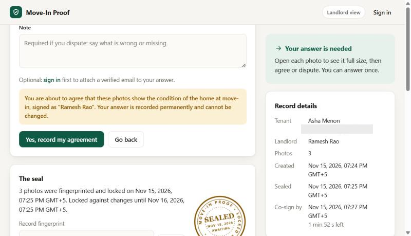

If the landlord never answers, a **timeout on the state** seals the record as "tenant only". The
evidence is locked either way.

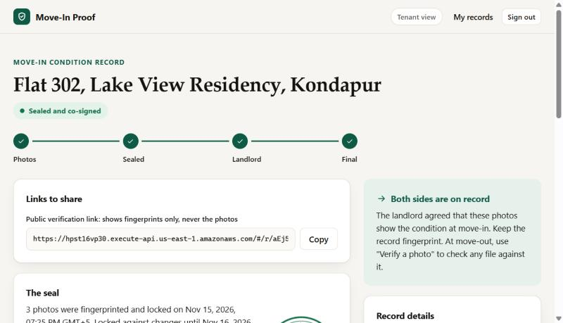

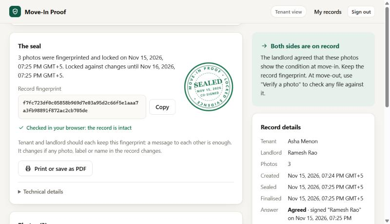

### 5. Verify at move-out

Pick a photo. It is fingerprinted **in the browser and never uploaded**. The exact file that was
sealed is highlighted as a match:

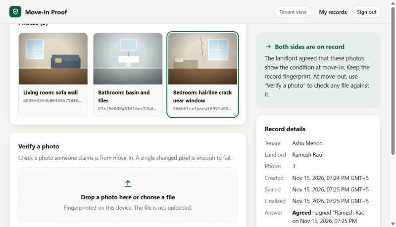

The same photo with a single byte added:

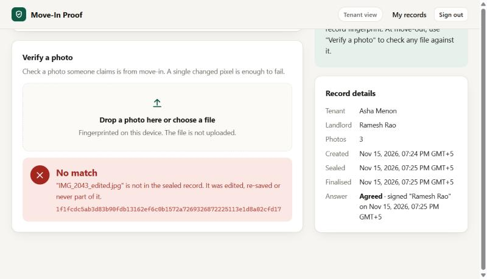

### 6. Anyone can verify, nobody can browse

The public link shows fingerprints only, never the photos, so a third party (a mediator, a court, a
new landlord) can check a photo without seeing the others.

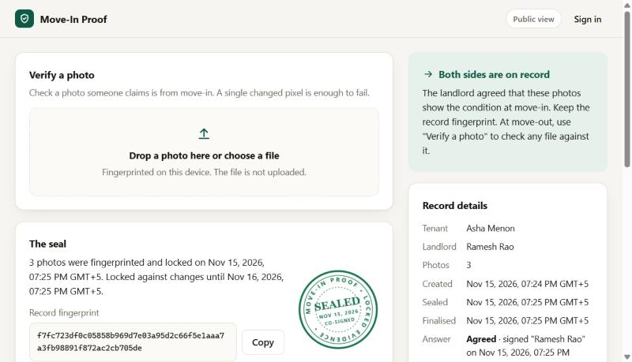

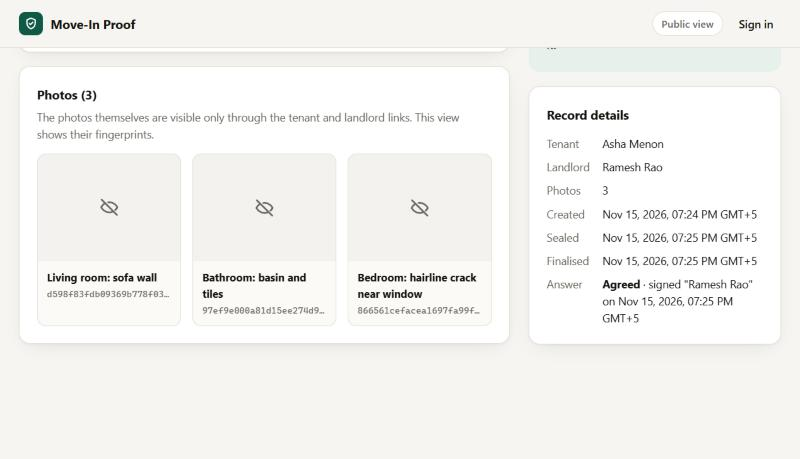

## Architecture

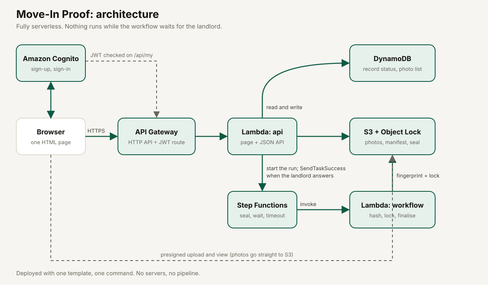

| Service | Job |
|---|---|
| **Amazon Cognito** | Registration, email confirmation, sign-in, password reset |
| **API Gateway (HTTP API)** | An open route and a JWT-protected `/api/my/{proxy+}` route in front of one Lambda |
| **Lambda `api`** | Serves the single page at `/` and the JSON API under `/api` |
| **Step Functions (Standard)** | Per-photo fan-out, the manifest, the wait for a human, the timeout |
| **Lambda `workflow`** | The small steps the state machine calls |
| **DynamoDB (on-demand)** | Record status; conditional writes stop double seals and double answers |
| **S3 (versioned, Object Lock)** | Photos, `manifest.json`, `seal.json` |

The workflow ([`statemachine/seal.asl.json`](statemachine/seal.asl.json)):

```
ListPhotos
  -> HashAndLockEachPhoto   Map state: SHA-256 the bytes, lock that object version
  -> SealManifest           write manifest.json under Object Lock
  -> WaitForLandlord        waitForTaskToken, timeout = co-sign window
       answered  -> FinalizeWithLandlordAnswer
       timed out -> FinalizeTenantOnly
  any failure before the wait -> RevertToDraft -> Fail
```

## Why Step Functions is the right tool

The landlord might answer in a minute or in three days. The workflow parks on a **task token** and
costs nothing while it waits. The timeout is one field on the state, not a cron job or a polling
Lambda. When the landlord answers, the API calls `SendTaskSuccess` and the workflow resumes exactly
where it stopped.

## Decisions worth reusing

- **Two doors, one handler.** `/api/...` is open; `/api/my/...` sits behind the API Gateway JWT
  authorizer. Owner-only actions need Cognito claims, so they can only succeed through the second
  door, and the Lambda never verifies a token itself.
- **Serve the page from the API Lambda.** No CloudFront, no second bucket, no CORS on the API.
- **Cognito without an SDK.** The page calls the Cognito API with `fetch`: no build step.
- **The landlord's secret lives in the URL fragment,** which browsers do not send to servers, so it
  stays out of access logs. Only its SHA-256 is stored.
- **After sealing, S3 is the source of truth.** The photo list is read from the locked manifest,
  not from DynamoDB.
- **Pin object versions.** A still-valid upload link can write a new version to the same key after
  sealing. The manifest records version IDs, so the record ignores it.
- **Conditional writes for one-time actions.** Seal and co-sign each flip a status with a condition,
  so a second click or a replay loses.
- **No email or SMS.** The tenant shares the link over whatever they already use, so there is no SES
  sandbox or SMS registration to wait for.

## How I tried to break it

Evidence is only worth something if a motivated person cannot get around it, so I wrote the attacks
first and then made each one fail.

| Attack | What happens | Proven |
|---|---|---|
| Delete a sealed photo | S3 refuses: "protected by object lock" | Live on AWS |
| Shorten a photo's lock to release it early | S3 refuses | Live on AWS |
| Re-upload a different file over a sealed photo using a still-valid upload link | The manifest pins object **version IDs**, so the record keeps showing the original | Test |
| Change one byte of a photo, then verify it | "No match" | Live on AWS |
| Add or remove photos after sealing | Rejected (409) | Test |
| Press "Seal" twice | The second is rejected; one workflow run only | Test |
| Landlord answers twice, or after the window closed | Rejected (409); the timeout result stands | Test (the timeout path itself ran live) |
| Tenant tries to co-sign as the landlord | Rejected (403) | Test |
| A stranger or the landlord link tries to add photos or seal | Rejected (403) | Test |
| Dispute with no reason | Rejected (400) | Test |
| Photo link issued but file never uploaded | Left out of the seal | Test |
| Seal with nothing uploaded | Record returns to draft with an error | Test |
| Call the signed-in API with no or a fake token | 401 from API Gateway | Live on AWS |

## What I tested

**On the deployed stack (us-east-1):**

- A seeded record went through the real workflow: Map state, locked manifest, then parked on the
  task token. S3 **refused both a delete of the locked photo version and an attempt to shorten its
  lock** ("protected by object lock"). After the 120-second window the run finished through
  `FinalizeTenantOnly`.
- The full path in a browser: register with an emailed Cognito code, create a record, upload photos
  through presigned POST, seal, co-sign through the landlord link without an account, and verify.
  The original photo returned "Match"; the same file with one byte added returned "No match".
- The JWT route returns 401 without a valid token.

**Locally:** 22 automated tests drive the API and workflow handlers through an in-memory stand-in
for AWS: the agree, dispute and timeout paths, swapping a photo after sealing, adding or removing
photos after sealing, sealing twice, answering twice, and using the wrong link or account for each
action.

**Not verified on the deployed stack:** password reset, a landlord co-signing while signed in (this
attaches a verified email; tested locally only), dark mode, and the printed layout.

## Limits

- A co-sign made **without an account** proves who held the link, not who the person is. A co-sign
  made while signed in carries a verified email, which is the stronger form.
- The seal proves the files are **unchanged since sealing**, not when the photos were taken. Seal on
  move-in day.
- Object Lock is in **governance mode**, so an account administrator with the bypass permission can
  still delete objects. Compliance mode removes that, but then nobody can delete test data early.
- Cognito's built-in email sender is limited to a small number of emails a day, which is fine for a
  demo and not for production.
- Photos are JPEG, PNG or WebP, up to 10 MB each and 30 per record.

## How it maps to the judging criteria

| Criterion | Where to look |
|---|---|
| **Technical innovation and originality** | A human-in-the-loop wait on a task token with a timeout fallback; evidence locked per object version; verification that happens in the browser |
| **Craft and execution** | One handler behind two API doors; conditional writes; fail-safe revert; 22 tests plus a real run against the deployed stack |
| **Usefulness and impact** | A real, common dispute (rental deposits) solved with a pattern anyone can reuse for vehicle handovers, equipment rentals and delivery condition reports |
| **Creativity and storytelling** | The problem in one sentence, a live demo, and a one-byte "No match" moment |

## Cost

Nothing is provisioned and nothing runs while idle: Lambda, API Gateway, DynamoDB (on-demand),
Step Functions and S3 are all pay-per-use, and a record that is waiting for its landlord costs
nothing while it waits. The standing cost is S3 storage for the photos you keep.

## What I would build next

- A PDF move-in report generated from the manifest, to hand to a mediator.
- Compliance-mode Object Lock for deployments where even an administrator must not be able to delete.
- A move-out inspection that compares new photos with the sealed ones, side by side.
- Email reminders to the landlord through SES, once out of the sandbox.

## Deploy it yourself

You need an AWS account and the AWS CLI signed in. No SAM CLI and no pipeline are required.

```bash
./deploy.sh
```

It prints the app URL. Demo defaults are a 120-second co-sign window and a 1-day lock; for real use
set `COSIGN_WINDOW=259200 RETENTION_DAYS=365` (or your lease length). With the SAM CLI the
equivalent is `sam build` then `sam deploy --guided`. See [README.md](README.md) for details and
cleanup.

## The pattern, beyond flats

Anything where two parties need to agree on "this is what it looked like then" has the same shape:
**fingerprint, lock, wait for a human with a timeout, verify later.** Vehicle handovers, equipment
rentals and delivery condition reports are the obvious ones.

---

Built by **Syed Moiz** for the AWS Builder Center weekend challenge.
